<!-- .slide: class="cover" -->

<div class="cover-card">
  <p class="cover-kicker" data-config="eyebrow">TALLER PRÁCTICO · PYTHON · MCP</p>
  <h1 class="cover-title" data-config="title">Tu Primer Servidor MCP</h1>
  <p class="cover-description" data-config="subtitle">Expón herramientas, recursos y prompts a aplicaciones de IA.</p>
  <div class="cover-separator"></div>
  <p class="cover-author" data-config="name">Jorge Jesús Quispe Villaverde</p>
  <p class="cover-role" data-config="role">AI Engineer · Applied AI Researcher · AI Mentor</p>
  <div class="contact-row" aria-label="Contacto del expositor">
    <a class="contact-email" data-config="email" href="mailto:jorgektch@gmail.com">jorgektch@gmail.com</a>
    <div class="contact-socials" aria-label="Redes del expositor">
      <a class="social-icon" data-social="github" href="https://github.com/jorgektch" aria-label="GitHub"><i class="fa-brands fa-github" aria-hidden="true"></i><span class="social-label">GitHub</span></a>
      <a class="social-icon" data-social="instagram" href="https://www.instagram.com/jorgektch" aria-label="Instagram"><i class="fa-brands fa-instagram" aria-hidden="true"></i><span class="social-label">Instagram</span></a>
      <a class="social-icon" data-social="tiktok" href="https://www.tiktok.com/@jorgektch" aria-label="TikTok"><i class="fa-brands fa-tiktok" aria-hidden="true"></i><span class="social-label">TikTok</span></a>
      <span class="social-handle" data-config="handle">/jorgektch</span>
    </div>
  </div>
</div>

<div class="readme-only">
  <p><strong>Tercer taller de la serie:</strong> una fuente Markdown para documentación y 49 diapositivas interactivas. Aprenderás a crear un servidor MCP oficial v2 con herramientas, recursos, prompts y un cliente real sin usar modelos comerciales.</p>
  <p><a href="https://jorgektch.github.io/tu-primer-servidor-mcp/">▶ Presentación</a> · <a href="https://jorgektch.github.io/tu-primer-servidor-mcp/demo/">🧪 Simulador visual (no conecta a MCP)</a> · <a href="notebooks/01_tu_primer_servidor_mcp.ipynb">📓 Notebook</a> · <a href="docs/REFERENCIAS.md">📚 Fuentes oficiales</a> · <a href="docs/GUIA_DEL_INSTRUCTOR.md">🎓 Guía del instructor</a>.</p>
  <p><strong>Ruta:</strong> función Python → contrato Tools/Resources/Prompts → servidor MCP → cliente stdio → Inspector → HTTP local → evaluación y seguridad. Requiere <strong>Python 3.11+</strong> para el SDK v2; los tests de catálogo y la demo web funcionan sin claves ni SDK.</p>
  <p><strong>Inicio rápido:</strong> <code>python 01_python_sin_mcp.py</code>, <code>pip install -r requirements.txt</code>, <code>python 02_probar_cliente_mcp.py</code>. Los precios e inventario son ficticios; no se realizan compras.</p>
  <p><strong>Continuidad:</strong> <a href="https://github.com/jorgektch/tu-primera-red-neuronal">Tu Primera Red Neuronal</a> → <a href="https://github.com/jorgektch/tu-primer-agente-ia">Tu Primer Agente de IA</a> → <a href="https://github.com/jorgektch/tu-primer-servidor-mcp">Tu Primer Servidor MCP</a>.</p>
</div>

Note: Introducir MCP como un protocolo de interacción. El servidor no es un modelo y no toma decisiones autónomas.


---

## 02 · Un problema de integración

Tenemos una tienda ficticia que sabe responder sobre **stock y precios**.

| Antes | Ahora |
|:--|:--|
| Cada app importa funciones Python | Varias apps pueden descubrir capacidades mediante MCP |
| Integración específica | Contrato de interacción común |
| La documentación se mantiene a mano | Schemas y capacidades se descubren |

**Pregunta:** ¿cómo permitir que otro cliente utilice esas funciones sin copiarlas?

Note: Pedir una propuesta antes de nombrar el protocolo.

---

## 03 · Objetivos del taller

1. Explicar la diferencia entre **host, cliente y servidor MCP**.
2. Construir **Tools, Resources y Prompts** con el SDK oficial.
3. Ejecutar un cliente real por **stdio** y observar sus resultados.
4. Probar **Streamable HTTP** e Inspector en desarrollo local.
5. Validar seguridad, entradas y contratos sin usar ningún LLM.

**Producto final:** servidor de inventario + cliente real + pruebas + demo conceptual.

Note: Distinguir cliente real de demo web ilustrativa.

---

## 04 · Ruta de siete módulos


Note: Dar un panorama del flujo, sin saltar todavía al código.

---

## 05 · De la serie al servidor MCP

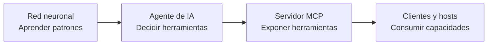

**No son equivalentes:** una red aprende parámetros; el agente puede decidir; el servidor MCP publica capacidades pero no necesita un LLM.

Note: Recordar los dos talleres previos.

---

## 06 · ¿Qué es Model Context Protocol?

**MCP es un protocolo abierto para conectar aplicaciones de IA con herramientas y fuentes de contexto**, mediante una interfaz estandarizada.

- **No** es un modelo de lenguaje.
- **No** es por sí mismo un agente autónomo.
- **No** equivale a una base de datos o a REST.
- Sí define cómo **descubrir, invocar y consumir** capacidades.

Lectura: [documentación oficial de MCP](https://modelcontextprotocol.io/).

Note: No confundir la metáfora de conector universal con garantías de autorización.

---

## 07 · Host, cliente y servidor

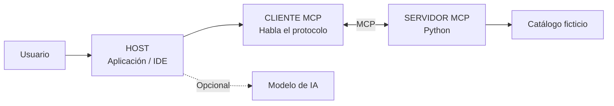

**Host:** aplicación que integra los servicios. **Cliente:** conexión MCP que usa el host. **Servidor:** expone capacidades. El modelo es opcional para este taller.

Note: Enfatizar dónde está el control y el aislamiento.

---

## 08 · Tres primitivas principales

| Primitiva | Qué expone | Uso habitual |
|:--|:--|:--|
| **Tool** | Función invocable | Consultar stock, cotizar |
| **Resource** | Información por URI | Catálogo, ficha de producto |
| **Prompt** | Mensaje reutilizable | Guion de cotización |

**Matiz:** el host decide qué publicar y permitir; una aplicación/usuario/modelo puede iniciar su uso según su interfaz. Las tres no son sinónimos.

Note: Evitar simplificar la gobernanza como propiedad exclusiva del LLM.

---

## 09 · El protocolo no es el transporte

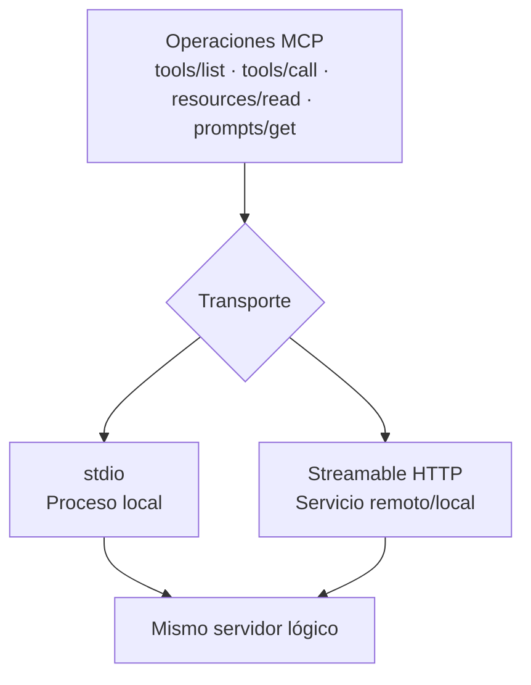

**stdio** es ideal para programas locales; **Streamable HTTP** para un endpoint. SSE independiente es un transporte heredado.

Note: SSE no es la recomendación para nuevas integraciones.

---

## 10 · Concepto JSON-RPC

Una llamada MCP puede transportarse como **mensajes estructurados**, con identificadores de solicitudes y resultados.

```json
{"jsonrpc":"2.0","id":1,"method":"tools/call","params":{"name":"consultar_stock","arguments":{"producto":"bicicleta"}}}
```

**Ilustración conceptual:** el SDK maneja formato, versiones y transporte; no hace falta construir a mano estos mensajes.

Note: No presentar el ejemplo como una traza literal de v2 en todos los transportes.

---

## 11 · MCP v2: cuidado con tutoriales antiguos

El SDK oficial de Python tiene una **línea estable v2**, con cambios respecto a v1:

```python
# v2 (este taller)
from mcp.server import MCPServer
mcp = MCPServer("Tienda-Educativa-MCP")
```

Los tutoriales antiguos pueden usar `from mcp.server.fastmcp import FastMCP`.

**Requisito:** Python 3.11+ y dependencias `mcp[cli]>=2,<3`.

[Guía de migración oficial](https://py.sdk.modelcontextprotocol.io/migration/).

Note: Mencionar que la compatibilidad del cliente/host depende del protocolo que soporte.

---

## 12 · Preparación del entorno

```bash
python --version
python -m venv .venv
# Windows: .venv\Scripts\Activate.ps1
# macOS/Linux: source .venv/bin/activate
python -m pip install -r requirements.txt
```

**Sin API keys:** no necesitas Gemini, OpenRouter ni Claude para construir y probar el servidor.

**Antes de instalar:** ejecuta `python 01_python_sin_mcp.py`.

Note: Python 3.11 o superior; si Windows usa py -3.12, adaptar comandos.

---

## 13 · Primero: la lógica de negocio

```python
from catalogo import consultar_stock, cotizar_producto
print(consultar_stock("bicicletas"))
print(cotizar_producto("bicicleta", 2))
```

**Resultado:** stock 3; cotización de **S/ 1700.00** (sin compra).

Esto todavía **no es MCP**: son funciones Python normales. Esa separación permite probarlas sin instalar el SDK.

Note: Ejecutar función delante de los asistentes antes de crear servidor.

---

## 14 · Un solo catálogo ficticio

| Producto | Stock | Precio |
|:--|--:|--:|
| Bicicleta | 3 | S/ 850.00 |
| Casco | 0 | S/ 120.00 |
| Candado | 5 | S/ 45.00 |
| Luz | 8 | S/ 35.00 |

`data/inventario.json` es la fuente compartida por Python y la demostración web.

*Para evitar errores monetarios, guardamos precios como enteros de céntimos.*

Note: No se realizan cambios ni ventas reales.

---

## 15 · La validación es parte del diseño

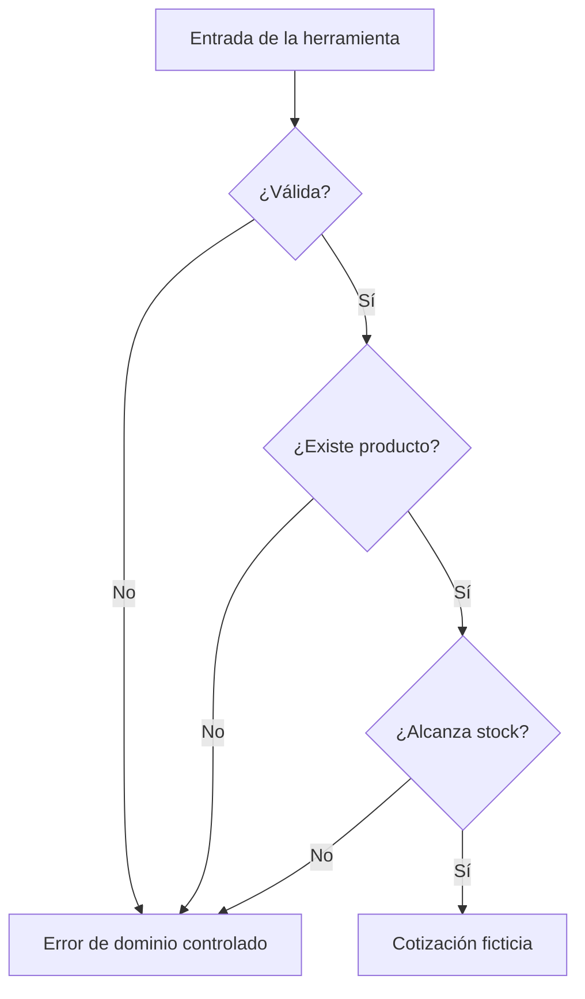

*Una herramienta debe validar sus argumentos incluso cuando los proponga un modelo.*

Note: El modelo no es una barrera de seguridad.

---

## 16 · Las herramientas como contrato

Una **Tool** publica nombre, descripción, tipos de entrada y un resultado.

```python
@mcp.tool()
def consultar_stock(producto: str) -> dict:
    """Consulta unidades disponibles de un producto ficticio."""
    return catalogo.consultar_stock(producto)
```

El SDK usa los tipos y el docstring para generar los esquemas del catálogo de herramientas.

Note: Observar qué cambia al agregar el decorador.

---

## 17 · El esquema de entrada

Para `cotizar_producto(producto: str, cantidad: int)`, un cliente puede descubrir:

```json
{
  "type": "object",
  "properties": {
    "producto": {"type": "string"},
    "cantidad": {"type": "integer"}
  },
  "required": ["producto", "cantidad"]
}
```

*Esquema simplificado para enseñanza; el SDK puede añadir metadatos.*

Note: Inspeccionar el schema efectivo usando Inspector o Client.list_tools.

---

## 18 · El servidor inicial

```python
from mcp.server import MCPServer
mcp = MCPServer("Tienda-Educativa-MCP")

@mcp.tool()
def consultar_precio(producto: str) -> dict:
    """Precio unitario en PEN del catálogo simulado."""
    return catalogo.consultar_precio(producto)

if __name__ == "__main__":
    mcp.run()  # stdio
```

El archivo completo está en [`servidor_mcp.py`](servidor_mcp.py).

Note: Mostrar la diferencia entre importar el módulo y ejecutar el servidor.

---

## 19 · Arquitectura del código

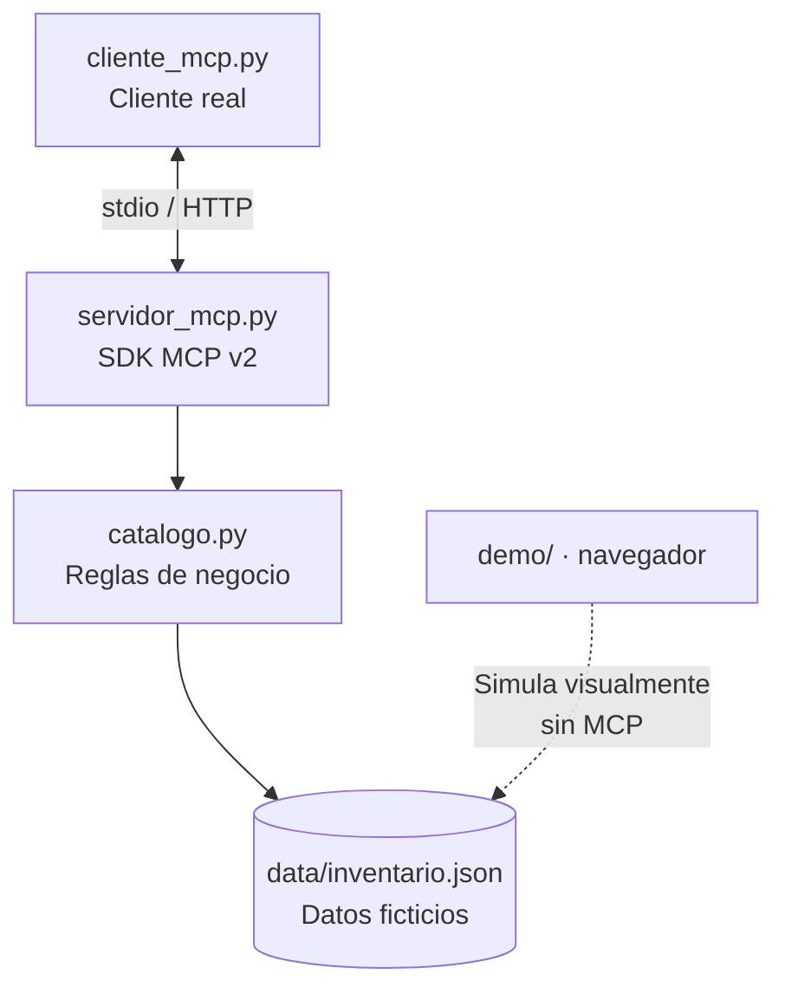

**Regla de arquitectura:** el SDK solo publica las funciones; la lógica está aislada y testeable.

Note: El explorador web NO es una implementación del protocolo.

---

## 20 · Resources: información, no acciones

```python
@mcp.resource("inventario://catalogo")
def recurso_catalogo() -> str:
    """Catálogo simulado de solo lectura."""
    return json.dumps(catalogo.inventario(), ensure_ascii=False)
```

Un Resource se identifica mediante una **URI** y el cliente puede obtener su contenido.

Ejemplo: `inventario://catalogo`.

Note: Un Resource es una forma de exponer contexto, no equivalente a ejecutar una compra.

---

## 21 · Resource Templates

```python
@mcp.resource("inventario://producto/{producto}")
def recurso_producto(producto: str) -> str:
    """Información de un producto específico."""
    ...
```

- Recurso fijo: `inventario://catalogo`.
- Plantilla de recurso: `inventario://producto/{producto}`.
- Lectura concreta: `inventario://producto/bicicleta`.

Se descubren con operaciones distintas: `resources/list` y `resources/templates/list`.

Note: Comparar en el Inspector las dos listas.

---

## 22 · Prompts: guías reutilizables

```python
@mcp.prompt()
def guion_cotizacion(producto: str, cantidad: str) -> str:
    """Construye una guía de cotización ficticia."""
    return f"Cotiza {cantidad} unidad(es) de {producto}..."
```

El cliente puede descubrir y solicitar esta plantilla con `prompts/list` y `prompts/get`.

**No confundir:** el Prompt no consulta el catálogo ni genera por sí solo una respuesta de un LLM.

Note: Un prompt ayuda a estructurar el trabajo del host.

---

## 23 · Mapa de capacidades publicadas

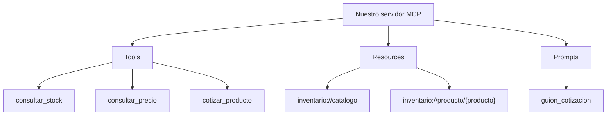

3 herramientas + 1 recurso fijo + 1 plantilla + 1 prompt.

Note: Repasar quién consume cada primitiva.

---

## 24 · Por qué usar stdio primero

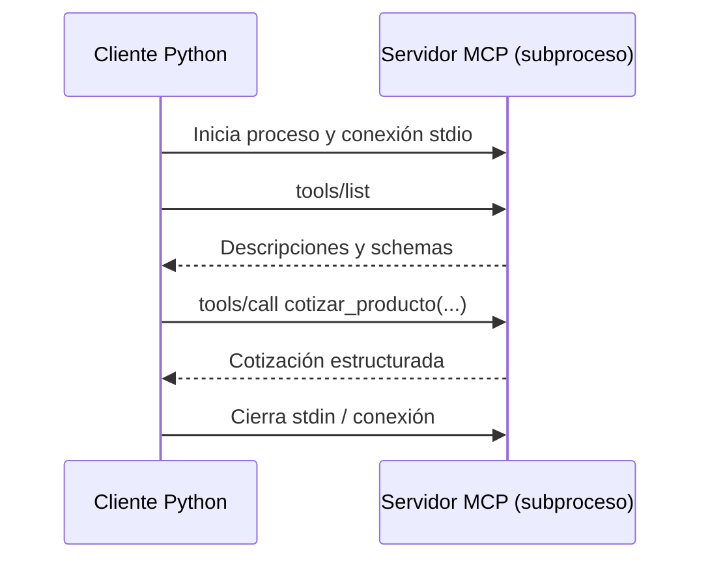

**Importante:** la salida estándar pertenece al protocolo. Para depurar, registra mensajes en `stderr`.

Note: No añadir print de inicialización al servidor.

---

## 25 · Cliente MCP: descubrimiento

```python
from mcp import Client, StdioServerParameters

params = StdioServerParameters(
    command="python", args=["servidor_mcp.py"]
)
async with Client(params) as client:
    tools = await client.list_tools()
    print([t.name for t in tools.tools])
```

El script real usa `sys.executable` y ruta absoluta para funcionar también en Windows.

Note: El cliente se conecta sin API keys ni LLM.

---

## 26 · Cliente MCP: ejecutar herramientas

```python
resultado = await client.call_tool(
    "cotizar_producto", {"producto": "bicicletas", "cantidad": 2}
)
if resultado.is_error:
    print("La herramienta devolvió un error")
else:
    print(resultado.structured_content)
```

`structured_content` es la salida legible por programas; los bloques de `content` se orientan al consumidor de contenido.

Note: Explicar que un error controlado de negocio no implica error del protocolo.

---

## 27 · Cliente MCP: Resources y Prompts

```python
recursos = await client.list_resources()
plantillas = await client.list_resource_templates()
documento = await client.read_resource("inventario://catalogo")
prompts = await client.list_prompts()
guion = await client.get_prompt(
    "guion_cotizacion", {"producto":"bicicleta", "cantidad":"2"}
)
```

Todas las llamadas pasan por el cliente real del SDK.

Note: Mostrar el archivo cliente_mcp.py completo.

---

## 28 · Demostración real en consola

```bash
python 01_python_sin_mcp.py
python -m pip install -r requirements.txt
python 02_probar_cliente_mcp.py
```

El cliente debe mostrar:

- 3 Tools, el Resource y el Prompt.
- `total` igual a **S/ 1700.00** para 2 bicicletas.
- Un recurso leído mediante su URI.

[Ver los scripts](cliente_mcp.py) · [Conectar a un host real](docs/CONEXION_HOSTS.md).

Note: Una llamada MCP no consume tokens de un modelo si no hay un LLM.

---

## 29 · Inspector: observar antes de integrar

```bash
mcp dev servidor_mcp.py
```

En **MCP Inspector**, inspecciona las pestañas **Tools**, **Resources**, **Resource Templates** y **Prompts**.

Prueba `cotizar_producto` con `producto=bicicleta` y `cantidad=2`.

**Nota:** Inspector utiliza herramientas de desarrollo y puede requerir Node.js; no es una web pública del repositorio.

Note: Primero explicar cómo detener Inspector y revisar permisos locales.

---

## 30 · Streamable HTTP: segunda opción

```bash
# Terminal 1: endpoint local
mcp run servidor_mcp.py --transport streamable-http

# Terminal 2: cliente
python cliente_mcp.py --http http://127.0.0.1:8000/mcp
```

En HTTP existe un endpoint; en stdio existe un subproceso. **El catálogo de capacidades es el mismo.**

No expongas este ejemplo sin autenticación a redes públicas.

Note: El comando de CLI y endpoint responden a SDK v2; verificar logs si cambia el puerto.

---

## 31 · Comparación de transportes

| Propiedad | stdio | Streamable HTTP |
|:--|:--|:--|
| Alcance | Local / subprocess | Puerto HTTP |
| Inicio | Host lanza servidor | Servidor persistente |
| Seguridad | Permisos del proceso | TLS, autenticación y red |
| Taller | Primer paso | Ampliación local |

**SSE** como transporte independiente está supersedido para desarrollos nuevos.

Note: No confundir un endpoint HTTP con una API REST genérica.

---

## 32 · ¿Dónde entra un agente de IA?

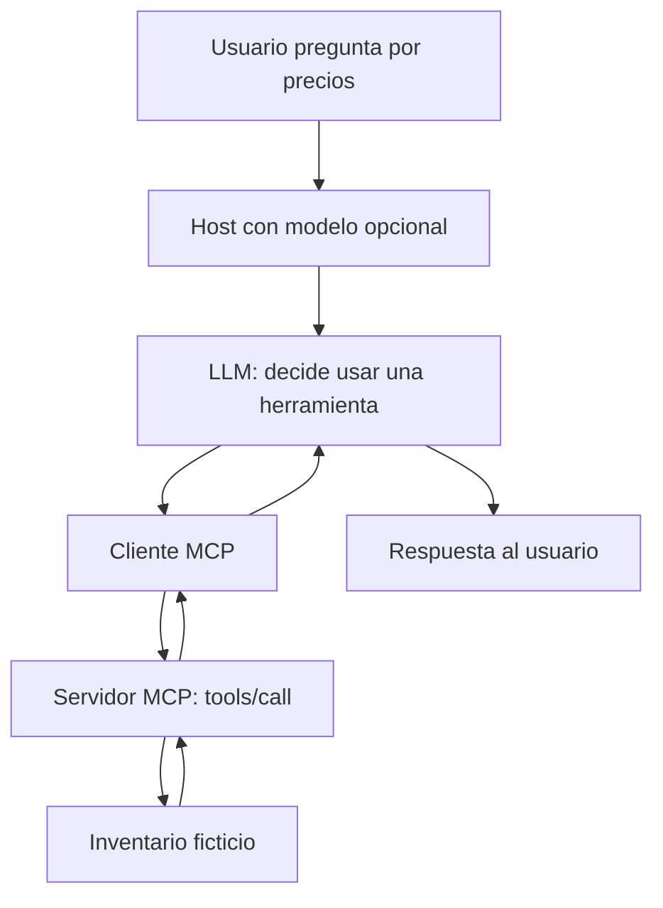

**El servidor no llama al modelo ni decide qué vender.** El host conserva el control.

Note: Conectar el taller anterior de agentes con este servidor.

---

## 33 · Un servidor, varios clientes

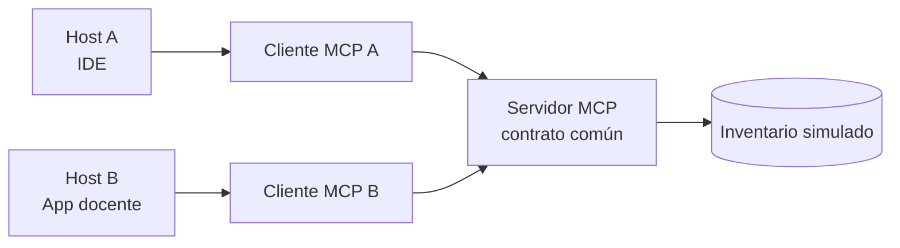

Un SDK reduce el esfuerzo de integración; **no elimina** permisos, autenticación ni compatibilidad entre hosts.

Note: Hay varias conexiones; no confundirlo con una única sesión global.

---

## 34 · Amenazas: los inputs no son confiables

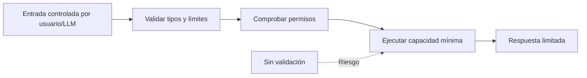

**Nunca** ejecutes comandos, rutas de archivo o URLs arbitrarias recibidas de herramientas sin restricciones explícitas.

Note: Mencionar inyección de prompts y datos no confiables.

---

## 35 · Seguridad para nuestro proyecto

- **Sin secretos** en README, JSON, notebooks ni demo.
- **Solo lectura:** ninguna herramienta modifica el inventario.
- **Validación:** cantidad entera de 1 a 100 y productos de catálogo.
- **Datos mínimos:** errores sin rutas internas ni stack traces.
- **Sin acceso a sistema de archivos arbitrario** ni comandos shell.
- **HTTP solo local:** añadir controles de autorización si se despliega.

Consulta [Seguridad](docs/SEGURIDAD.md).

Note: Usar ejemplos concretos sin exponer tokens.

---

## 36 · Errores: negocio vs protocolo

| Tipo | Ejemplo | Tratamiento |
|:--|:--|:--|
| Dominio | Casco sin stock | Resultado `ok:false`, código |
| Validación | Cantidad = 0 | Rechazar cantidad |
| MCP | Tool desconocida | `is_error` o error del protocolo |
| Infraestructura | Proceso no inicia | Revisar dependencias / logs |

**Regla:** el cliente inspecciona `is_error` y la salida estructurada antes de utilizar un resultado.

Note: Destacar dónde se registran los errores.

---

## 37 · Matriz de evaluación reproducible

| Caso | Resultado esperado |
|:--|:--|
| Cotizar 2 bicicletas | S/ 1700.00 |
| Consultar casco | 0 unidades |
| Cotizar 1 casco | `STOCK_INSUFICIENTE` |
| Consultar patineta | `PRODUCTO_NO_ENCONTRADO` |
| Cantidad 0 o booleana | `CANTIDAD_INVALIDA` |
| Leer inventario | 4 productos |

Ejecuta `python -m unittest discover -s tests -p 'test_mcp_*.py' -v`.

Note: Las pruebas de lógica offline no necesitan SDK.

---

## 38 · Pruebas en tres capas

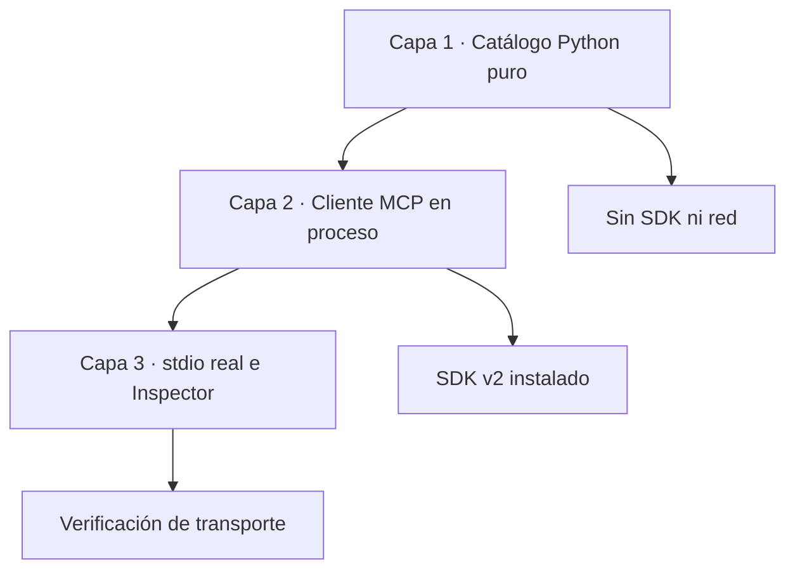

En CI se instala el SDK v2 para comprobar **descubrimiento, ejecución y recursos**; la demo web solo verifica el flujo conceptual.

Note: Una prueba en proceso no sustituye del todo a un test stdio.

---

## 39 · Laboratorio visual sin LLM

Abre [**Explorador didáctico**](demo/) y observa las llamadas del cliente:

1. `tools/list`: descubre capacidades.
2. `tools/call`: cotiza bicicletas o consulta stock.
3. `resources/read`: inspecciona el catálogo.
4. `prompts/get`: ve una plantilla preparada.

**La demo web es una simulación del intercambio, no conecta con el proceso MCP real.**

Note: Explicar sin ambigüedad la separación entre simulación y servidor.

---

## 40 · Reto 1 · Agrega una herramienta

Implementa `obtener_categoria(producto: str)` que retorne la categoría desde el catálogo.

**Criterios:**

- Debe consultar `catalogo.py`.
- Debe registrar `@mcp.tool()`.
- Debe dar error controlado para productos desconocidos.
- Debe aparecer en `list_tools()`.

Consulta los [retos](ejercicios/retos.md), pero inténtalo antes de abrir las soluciones.

Note: Pensar primero en el contrato y la prueba.

---

## 41 · Reto 2 · Crea otro recurso

Expón un recurso inmutable `inventario://politicas` que explique que todo es una simulación.

**Preguntas:**

- ¿Qué URI usarías?
- ¿En qué se diferencia de un Prompt?
- ¿Quién debería poder leerlo?
- ¿Cómo comprobarías que no tiene datos privados?

Note: Los recursos son contenido; no darles efectos secundarios.

---

## 42 · Reto 3 · Prueba con Inspector

Completa una tabla de observaciones:

| Operación | ¿Qué observa el cliente? |
|:--|:--|
| `tools/list` | Nombres, descripciones y schemas |
| `tools/call` | Salida estructurada |
| `resources/read` | Contenido del recurso |
| `prompts/get` | Mensaje renderizado |

Entrega una captura **sin credenciales ni rutas sensibles**.

Note: No requiere conectar ningún modelo externo.

---

## 43 · Reto 4 · Modela los límites

Analiza estos intentos:

- `cotizar_producto("casco", 1)`.
- `cotizar_producto("bicicleta", 0)`.
- `cotizar_producto("bicicleta", true)`.
- `cotizar_producto("patineta", 2)`.
- Solicitud para borrar o alterar inventario.

**Debate:** ¿cuál es un error de dominio, cuál de validación y cuál requiere una capacidad que no existe?

Note: El servidor no puede ni debe inventar una herramienta de venta.

---

## 44 · Propuesta de integración real

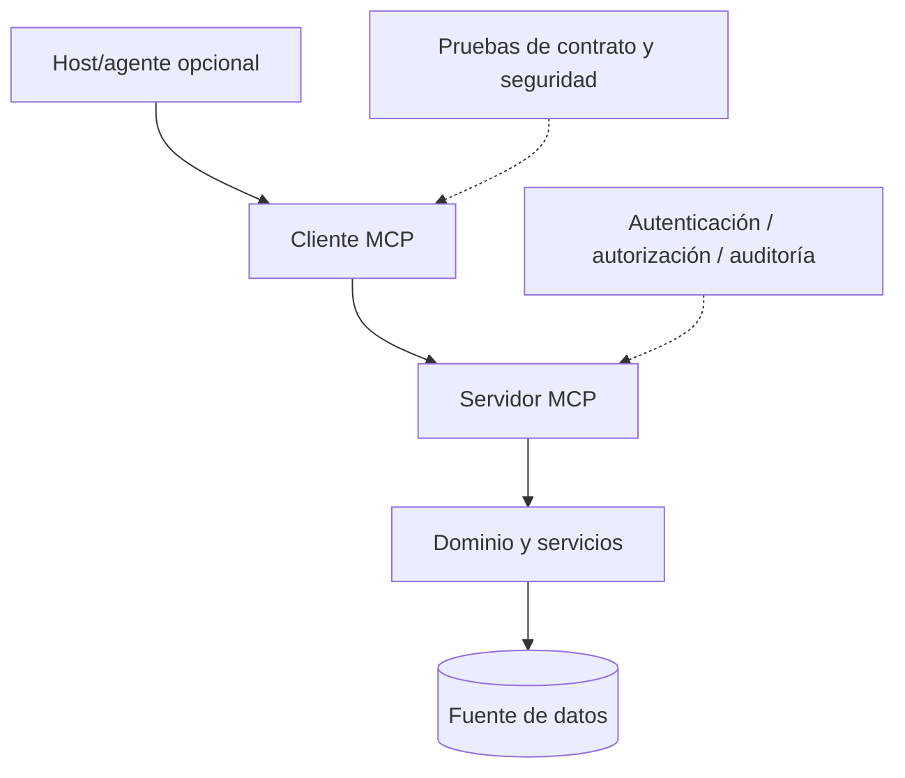

**Para producción:** autorización específica, registros, observabilidad, límites y aislamiento según riesgos.

Note: Esta es arquitectura objetivo, no función incluida en el taller.

---

## 45 · Tres talleres, una ruta formativa

| Taller | Pregunta principal | Entregable |
|:--|:--|:--|
| [Tu Primera Red Neuronal](https://github.com/jorgektch/tu-primera-red-neuronal) | ¿Cómo aprende un modelo? | MLP desde cero |
| [Tu Primer Agente de IA](https://github.com/jorgektch/tu-primer-agente-ia) | ¿Cómo usa herramientas? | Agente Python con LLM |
| **Tu Primer Servidor MCP** | ¿Cómo se publican capacidades interoperables? | Servidor y cliente MCP |

Son complementarios, pero ninguno depende obligatoriamente del anterior.

Note: Reforzar que MCP no necesita LLM para ejecutarse.

---

## 46 · Referencias: especificación y SDK

Fuentes verificables para lo implementado:

- [MCP — introducción y arquitectura](https://modelcontextprotocol.io/).
- [SDK oficial de Python v2 — primeros pasos](https://py.sdk.modelcontextprotocol.io/get-started/first-steps/).
- [Tools, Resources y Prompts](https://py.sdk.modelcontextprotocol.io/servers/tools/).
- [Cliente oficial y transporte stdio](https://py.sdk.modelcontextprotocol.io/client/transports/).
- [Guía de migración v1 → v2](https://py.sdk.modelcontextprotocol.io/migration/).
- [Buenas prácticas de seguridad](https://modelcontextprotocol.io/specification/).

Bibliografía ampliada en [docs/REFERENCIAS.md](docs/REFERENCIAS.md).

Note: Aclarar que nuestros diagramas son originales, no reproducciones de la especificación.

---

## 47 · Checklist de salida

- [ ] Explico **host, cliente y servidor**.
- [ ] Ejecuto `01_python_sin_mcp.py` sin dependencias.
- [ ] Registro y descubro **Tools, Resources y Prompts**.
- [ ] Ejecuto `02_probar_cliente_mcp.py` por stdio.
- [ ] Reviso las pruebas offline y de SDK.
- [ ] Distingo la demo web simulada del cliente MCP real.
- [ ] Reconozco límites de seguridad y permisos.

Note: Diferenciar comprensión conceptual de ejecución comprobada.

---

## 48 · ¿Qué construimos?

**Una biblioteca de negocio reutilizable, un servidor MCP y un cliente MCP real.**

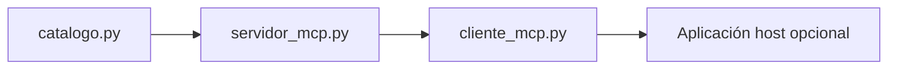

**Sin modelo ni API keys.** El siguiente paso es conectar estas capacidades a un host con políticas de seguridad adecuadas.

Note: Resumir en 30 segundos y proponer una extensión.

---

## 49 · Cierre · Tu Primer Servidor MCP

**Aprendiste a exponer capacidades, no a delegar decisiones ciegamente.**

[Repositorio del taller](https://github.com/jorgektch/tu-primer-servidor-mcp) · [Demo conceptual](demo/) · [Ejercicios](ejercicios/retos.md) · [Guía docente](docs/GUIA_DEL_INSTRUCTOR.md)

**Write once. Document and present anywhere.**

Note: Invitar a modificar una herramienta y agregar una prueba.
