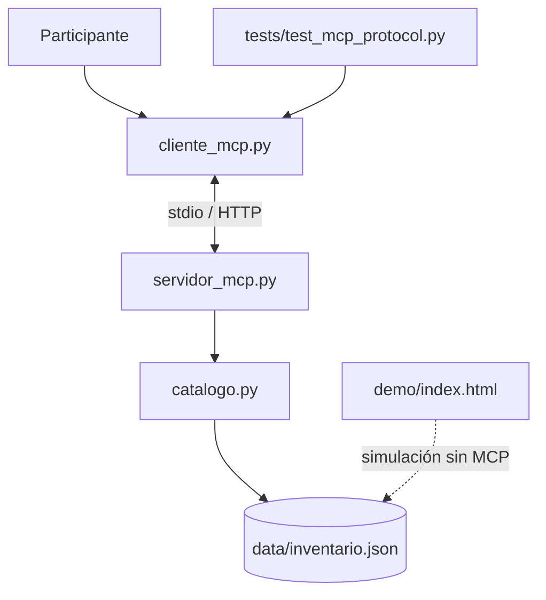

# Arquitectura del taller

**Separación por responsabilidades**

- `catalogo.py`: datos y reglas puras, validación de producto, cálculos monetarios exactos y respuestas tipadas en diccionarios. No conoce el SDK.
- `servidor_mcp.py`: publica tres Tools, un Resource fijo, una plantilla de Resource y un Prompt mediante los decoradores oficiales de MCP v2.
- `cliente_mcp.py`: descubre e invoca capacidades reales a través de stdio o Streamable HTTP.
- `demo/`: explica visualmente el formato conceptual de solicitudes y respuestas; no habla con un servidor MCP real.
- `tests/`: valida lógica de dominio y, cuando el SDK está instalado, el protocolo real en memoria y en un subproceso.

**Decisión central:** no publicar rutas arbitrarias, no ejecutar comandos remotos, no modificar inventario, no almacenar API keys. El servidor no llama a modelos.

## Casos de uso educativos

1. `consultar_stock("bicicleta")` — 3 unidades.
2. `cotizar_producto("bicicletas", 2)` — S/ 1700.00.
3. `cotizar_producto("casco", 1)` — dominio `STOCK_INSUFICIENTE`.
4. `resources/read("inventario://catalogo")` — catálogo ficticio.
5. `prompts/get("guion_cotizacion", ...)` — texto del guion de atención.

La demostración **no** modifica el inventario. Para uso real con datos privados se necesita diseñar controles de acceso, privacidad, auditoría, límites, aislamiento y despliegue según riesgos.
